  
  
  

# C++ Practice

My C++ practice work: the homework from the course, and the ASCII doughnut
animation.

## What is here

**`C++ problem solving/`** — the course homework, `HWs course 3`. 92
solutions, one Visual Studio project per problem, in the numbered folders
(`Problem #1`, `Problem #11-13 cin`, `Problem #35-45`, and so on). Each
project holds the solution `.cpp` with its `.sln`, `.vcxproj` and
`.vcxproj.filters`, and each problem folder has a screenshot of what the
program printed.

**`C++ Donut/`** — the ASCII doughnut animation, with the upstream project
kept as the original download (`ASCII-Doughnut-master.zip`, which carries its
own licence).

## Building a solution

Open the `.sln` in Visual Studio and build. The projects target Windows and
use the Windows console API for the doughnut, so that one needs Windows; the
homework solutions are plain standard C++.

## What is deliberately not here

The Visual Studio build output and caches are excluded by `.gitignore`. The
IntelliSense precompiled-header cache alone was about 4 GB in this folder, and
none of it is the work. Everything is rebuilt by opening the project and
pressing build.

## Topics covered

Input and output, math, `if` / `else if` / `switch`, loops with `break` and `continue`, functions, structs, enums (including enums with nested functions), and more across the numbered problems.

## A taste of the code

The doughnut is the fun one: it is an ASCII-art doughnut animation drawn with console characters. Open `C++ Donut/` for it.
